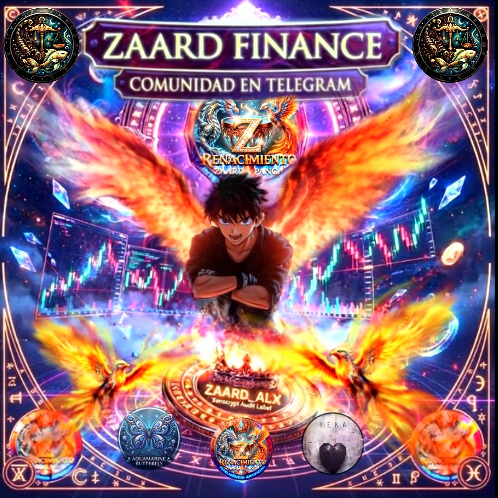

.svg)

---

 

## 🚀 Sobre el Ecosistema ZAARD
**ZAARD & PANGA** es un ecosistema descentralizado de alta gama que fusiona la innovación financiera, la inteligencia artificial y colecciones digitales exclusivas. Este repositorio unifica todo el código fuente, pasarelas, accesos directos verificados y herramientas de gestión para garantizar una experiencia Web3 transparente, rápida y segura.

---

## 💎 Directorio Central: Todo el Ecosistema ZARD

Accede a todas las plataformas, herramientas y canales oficiales del proyecto de forma directa:

| Módulo / Herramienta | Descripción Técnica | Enlace de Acceso Oficial |
| :--- | :--- | :--- |
| ⚡ **Creation FINANCE** | DApp principal de innovación y staking | [Acceder a la DApp](https://figueredo56.github.io/zaard-innovation-dapp/) |
| 💼 **ZAARD Wallet** | Aplicación descentralizada de gestión de activos | [Abrir Wallet](https://figueredo56.github.io/zaard-wallet/wallet.html) |
| 🖼️ **ZAARD NFT Hub** | Colecciones digitales exclusivas, arte y utilidad | [Ver Colección NFT](#-sección-de-nfts-y-activos-digitales) |
| 📢 **Canal de Telegram** | Comunidad global y actualizaciones en tiempo real | [Unirse al Telegram](https://t.me/+Cjo5z_yXcdwzYjM5) |
| 🐦 **Twitter / X** | Anuncios oficiales y noticias de última hora | [@ZAARD_ALX](https://x.com/ZAARD_ALX) |
| 💬 **Discord** | Soporte técnico, gobernanza y canales de voz | [Entrar al Servidor](https://discord.gg/GGbzY9FR2) |
| 🌐 **Reddit** | Debates de la comunidad, hilos y propuestas | [Comunidad Reddit](https://www.reddit.com/u/Old-Operation6245/s/bB5dWEDjO5) |
| 👔 **LinkedIn** | Perfil corporativo e institucional del proyecto | [Ver Perfil LinkedIn](https://www.linkedin.com/in/zaard-inovation-45284a408) |

---

## 🎨 Sección de NFTs y Activos Digitales (ZAARD Digital Art)
El ecosistema de ZAARD integra coleccionables digitales únicos vinculados al lore de Panga e Inteligencia Artificial:

* **Utilidad en el Ecosistema:** Los NFTs de ZAARD no son solo arte digital, actúan como llaves de acceso, multiplicadores de recompensas en las DApps y elementos de gobernanza.
* **Pares de Liquidez Verificados:** Ecosistema totalmente verificado en Coingecko con pares de liquidez activos respaldando los activos digitales.
* **Diseño Evolutivo:** Arte enfocado en temáticas cyberpunk, IA y mitología guerrera.

---

## 🛠️ Stack Tecnológico y Seguridad
* **Frontend:** HTML5, CSS3, JavaScript avanzado con animaciones fluidas y diseño responsivo adaptado para dispositivos móviles y escritorio.
* **Estética Visual:** Interfaz futurista basada en tonos oscuros, neón azul cian (`#00f2fe`) y morado vibrante (`#a855f7`).
* **Seguridad Web3:** Protocolos rigurosos orientados a proteger a la comunidad frente a suplantaciones de identidad y estafas.

---

### 🛡️ Nota de Seguridad Importante
*El equipo oficial de ZAARD **NUNCA** te solicitará tus claves privadas (Seed Phrase), frases semillas ni te contactará por mensaje directo primero para pedirte fondos.*

**¡Transparencia, descentralización y evolución constante hacia el futuro!** 🚀

---

## 🌐 Our Official Digital Presence

Stay connected with the true source of ZAARD innovation.

* **🏠 Official Website:** [https://figueredo56.github.io/zaard-official/](https://figueredo56.github.io/zaard-official/)
* **🐦 Official X (Twitter):** [@ZAARD_666](https://x.com/ZAARD_666)
* **💰 Binance User Profile (Founder/DAO):** [View on Binance](https://account.binance.com/register?ref=776427353&?registerChannel=user_center) (User ref: 776427353)
## 👤 Founder & Lead Developer
Desarrollado por **Aracelis (Panga)** - Founder de ZAARD INNOVATION.

---
---

> **⚠ CAUTION: Disclaimer ⚠**
> This repository is for code review and transparent verification. Interacting with smart contracts involves risk. Ensure you are using the officially verified website and channels. This code is not an invitation to invest.

- **Red:** BNB Smart Chain (BSC)
- **Contrato:** `0x973ba2c1dccd0820f1e026d6b1f01c55c4085d38`
- **Contrato:** `0x4a6c3ea9e7132ad217c31f8252119f08c801366e`
- **Contrato:** `0x073c12c7072676c9a1afd83c07e470aa7d81aeb3`
- **Contrato:** `0x5a1de9974c1279fbe989ce32899a1f4ece3fc53d`
---
© 2026 **ZAARD INNOVATION** | **Lead Dev: Panga** | *Exponential Ascent & Verified Security*
